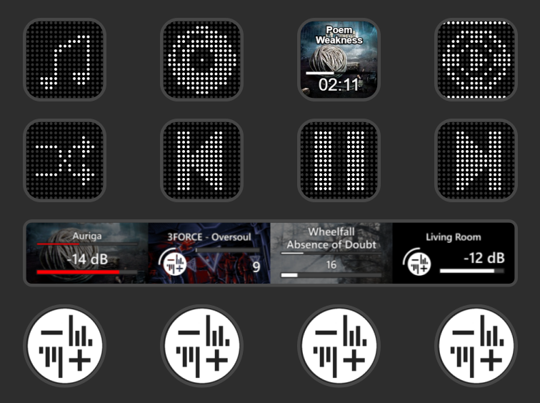
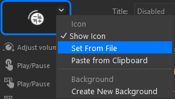

# Roon: Dialed Up

A Stream Deck plugin for controlling [Roon](https://roon.app) playback, built on top of the Stream Deck+'s dials, touchscreen and buttons.

Install it from the [Elgato Marketplace](https://marketplace.elgato.com/product/roon-dialed-up-f76699d9-4266-4d4a-ad94-eaddd148daa9).

This started as a fork of Tomi Blinnikka's [streamdeck-roon](https://github.com/docBliny/streamdeck-roon). None of this would exist without his foundational work, made possible because he open-sourced the project and opened it up for anyone to build on. The codebase has changed substantially since then (new icon system, touchscreen customization, dial support, and more), but the foundation and the original idea are his. Licensed MIT, same as the original; see [LICENSE](LICENSE).



## Features

### Buttons

- Play / Pause (album art, artist/track, track time, total time, and progress bar, each independently toggleable; the track time can count up or show the time remaining, and the play/pause icon itself can be hidden so only the track info shows)
- Play
- Pause
- Stop
- Play This / Play Item
- Previous
- Next
- Loop All / Loop One (independent toggles)
- Shuffle mode (on / off)
- Volume up
- Volume down
- Volume set
- Mute / Unmute
- Roon Radio on/off
- Add to Library / Heart (experimental, see below): a "+" that adds the playing track to your library, then a heart to favorite it
- Connection Status (a light that shows whether the plugin is connected to your Core, with an optional Core name underneath)
- Launch App and Search (open [Roon: Toasted](https://github.com/Vulkandr/roon-toasted), my companion app)

### Dials (Stream Deck+)

- Adjust Volume: rotate to change volume, short press to mute/unmute (or play/pause, if set to that mode), long press to mute/unmute all zones
- Grouped zones: the volume keys and the Adjust Volume dial change every output in a Roon group at once (see below)
- Player Controls: play/pause on press, previous/next on rotation, hold-to-mute on the touchscreen, with a Show Volume toggle to switch its touchscreen layout between a centered display and one that includes the volume readout

### Customization

- Three icon styles: LED Grid, LED, and Classic, with a full color picker for the LED styles
- Two text fonts, chosen per key or dial: Classic (the original Arial-style look) and Condensed (narrower, fits more text per line)
- Touchscreen title display: off, output name, or artist and song
- Touchscreen progress bar: off, replacing the volume bar, or as its own row
- Optional logo, hiding it frees up horizontal space for the rest of the layout
- UI and album art transparency sliders
- Independent text and bar color pickers

## Using the Roon logo

The Roon logo isn't bundled with the plugin, to avoid shipping any copyrighted assets. If you'd like it as your icon, save your own copy of the logo, then in the Stream Deck software click the small dropdown arrow on the corner of the action's icon and choose **Set From File** to select it.



## Installation

Requires Stream Deck software 7.1 or later. The button actions work on any Stream Deck; the two Dial actions need a Stream Deck+.

**Elgato Marketplace:** [Roon: Dialed Up](https://marketplace.elgato.com/product/roon-dialed-up-f76699d9-4266-4d4a-ad94-eaddd148daa9). This is the easiest way to install it and keep it updated.

**Manual:** build from source and package it (see "Build a release package" below), then double-click the resulting `.streamDeckPlugin` file to install it.

## Configuration

Add one of the Roon actions to your Deck. Its settings are split into tabs: **Connection** (your Roon Core and the output the key controls), **Options** (icon style, text font, and the key's own settings), and on dials, **Screen** (the touchscreen layout). The plugin finds your Roon Core on its own; when it does, the **Connection** tab shows a green light and the Core's name.

Open Roon, go to **Settings → Extensions**, find **Roon: Dialed Up**, and click **Enable**. This is a one-time step per Core.

Then pick the output (zone) the button should control under **Output** on the Connection tab. Each button remembers its own output. A new button picks one for you: the output you chose last, or whatever is playing.

**If your Core isn't found for whatever reason**, click **Manual** next to the Core name, enter the Core's IP address (or hostname) and port (usually `9330`), and click **Connect**. The address is remembered. **Rescan** looks for Cores again, and the **Available Cores** list lets you switch between Cores you have enabled.

**Add to Library / Heart (experimental).** One key that follows the playing track: a "+" when the track isn't in your library (press to add it: just the song, or its whole album, as set in the key's options), an outline heart once it is (press to heart it), and a filled heart when hearted (press to un-heart; it never removes anything from your library). Roon's official extension API can't do either of these, so this key talks to the Core over the protocol Roon's own apps use, through my [roon-library-controls](https://github.com/Vulkandr/roon-library-controls) package, on a separate connection. The plugin only opens it once an Add to Library / Heart key has been on screen, keeps it open while any Dialed Up key or dial is visible (so the key is ready right away after a page change), and closes it 10 minutes after the last one leaves the screen. That part of Roon isn't officially open to apps, so a Roon update may break it until the plugin catches up; when the Core turns the plugin down, the key dims and its settings say "Not supported with this Roon version". Nothing else in the plugin depends on it.

**Grouped zones.** When the chosen output is part of a Roon group, the Volume Up, Volume Down, Volume Set and Mute keys and the Adjust Volume dial control the whole group, the same as the group + and − buttons in Roon's volume popup: each output moves by its own step, and the level shown is the group lead's (the output the group was made from). The dial's title shows the group as "Living Room + Kitchen", or "Living Room + 1" when the names don't fit. Volume Set puts the lead at the level you set and moves the others by the same number of steps. Outputs with fixed volume are skipped. For the outputs to move evenly, set them all to DSP Volume in Roon. To control only the chosen output, turn off **Control whole group** in the key's Options tab. In the output list, grouped outputs sit together inside one border, lead first, with a chain between them.

**Roon: Toasted buttons.** The Launch App and Search actions open [Roon: Toasted](https://github.com/Vulkandr/roon-toasted) (my companion app) and do nothing if it isn't installed. Their settings show whether Toasted is running, with a Launch button when it isn't. Windows only.

## Upgrading from 1.x

Your existing buttons and your Roon authorization carry over, so there is nothing to re-enable in Roon. The old host and port fields are gone in favor of automatic discovery, with a Manual button as a fallback.

## Reporting a problem

If something misbehaves, the plugin's log files help a lot. They're in `%APPDATA%\Elgato\StreamDeck\Plugins\com.vulkan.roon-dialed-up.sdPlugin\logs`. A new file starts every time Stream Deck starts, so right after restarting Stream Deck, the files ending in `.1` (the session that had the problem) and `.0` (the fresh one) are the useful pair. Attach them to a [GitHub issue](https://github.com/Vulkandr/streamdeck-roon-dialed-up/issues) or send them to me on the [Roon forum](https://community.roonlabs.com/t/325520).

## Local development

### Source code

The plugin is TypeScript on the Stream Deck SDK v3 (Node.js). Source is in `src/`; the settings panel is `com.vulkan.roon-dialed-up.sdPlugin/ui/roon.html`.

```
npm install
npm run build
```

`npm run build` bundles the plugin into `com.vulkan.roon-dialed-up.sdPlugin/bin` and copies the Roon libraries it needs into that folder's `node_modules`. To try it in Stream Deck, see "Run without installing" below, or "Build a release package" to make an installer.

### Run without installing

Install Elgato's [Stream Deck CLI](https://docs.elgato.com/streamdeck/cli/intro), then link the built folder into Stream Deck and rebuild on change:

```
npm install -g @elgato/cli
streamdeck link com.vulkan.roon-dialed-up.sdPlugin
npm run watch
```

Stream Deck locks a plugin's files while it is running, so quit the app before replacing the folder by hand.

### Test build next to the installed plugin

`npm run tester` builds the plugin and makes a copy called **Roon: Dialed Up Tester** in `com.vulkan.roon-dialed-up-tester.sdPlugin`, with its own plugin ID and its own category in the action list, so it installs beside the released plugin without touching your existing keys. Copy that folder into `%APPDATA%\Elgato\StreamDeck\Plugins\` and restart the Stream Deck app. It registers in Roon as its own extension, so enable it once under Settings → Extensions. Each build gets a new build number, so it always replaces the previous tester.

### Build a release package

- Bump the version in `package.json`, `package-lock.json` (two places), `Version` in `manifest.json` (`major.minor.patch.build`, for example `2.1.2.0`), and `display_version` in `src/roon-connection.ts` (the version Roon shows under Settings → Extensions).
- `npm run build`
- `streamdeck validate com.vulkan.roon-dialed-up.sdPlugin`
- `streamdeck pack com.vulkan.roon-dialed-up.sdPlugin`

### Fonts

Text on keys and the touchscreen is drawn as vector outlines from the fonts in `com.vulkan.roon-dialed-up.sdPlugin/fonts/` (Liberation Sans and Fira Sans Condensed, both under the SIL Open Font License; see `OFL.txt` there). Liberation Sans is metrically identical to Arial, which the original plugin used.

## Misc

Roon is a trademark or registered trademark of Roon Labs LLC.

Elgato, Corsair, and Stream Deck are trademarks or registered trademarks of Corsair GmbH.
